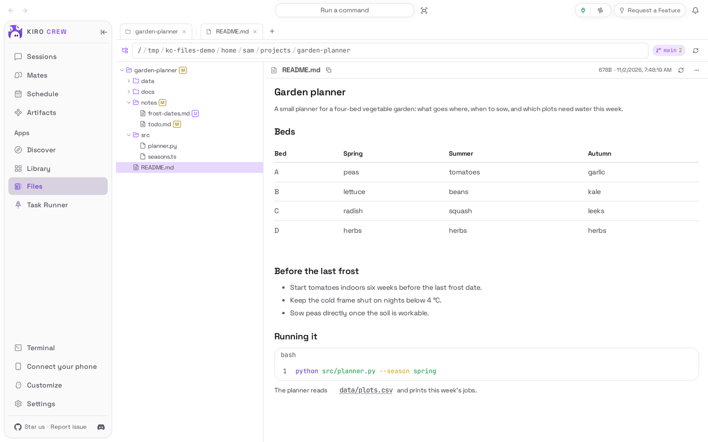
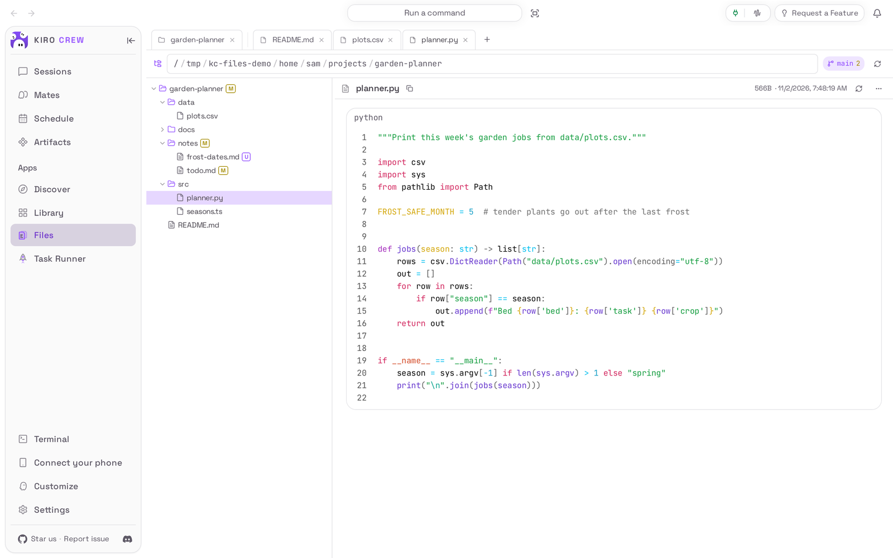
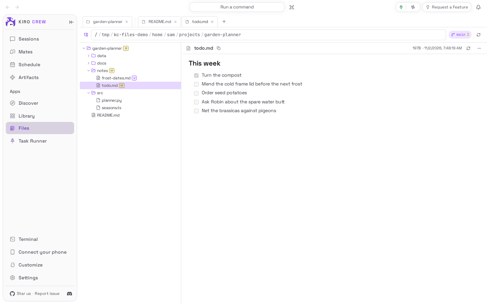
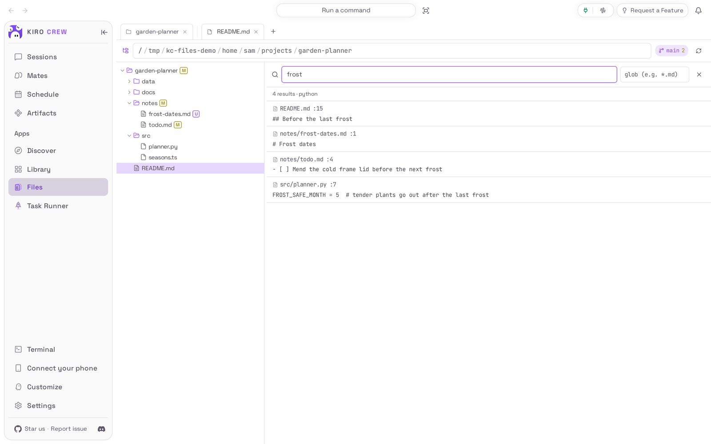

# Files

<picture>
  <source media="(prefers-color-scheme: dark)" srcset="docs/media/hero-dark.png">
  
</picture>

**Browse, read and search the files on your Kiro Crew computer, without changing any of them.**

Files is an app for [Kiro Crew](https://github.com/kirodotdev/KiroCrew),
the open-source personal AI agent.

## What it is

Files adds a **Files** page to Kiro Crew. It shows the folders on the computer
that runs Kiro Crew as a tree, opens files in tabs, shows markdown as formatted
text and code with colours, marks the files git sees as changed, and searches a
whole folder for a word. It only reads: it never edits, moves or deletes a file.

**Get started:** Files already comes with Kiro Crew, switched off. Open
**Apps → Library**, choose **Show N disabled apps** (N is how many apps are
switched off), then on the **Files** tile open the **⋯** menu and choose
**Enable**. [Install](#install) has the details.

## The problem it solves

Your agent works with files on the computer that runs Kiro Crew: notes, a
project, the reports it wrote. To look at one you would normally leave the
dashboard for a terminal or a file manager, and if Kiro Crew runs on another
machine, you may not have either.

Files puts a read-only view of those folders inside the dashboard. Because it
cannot write, opening it can never change your work by accident.

## Top 3 use cases

### 1. Read notes and code side by side

You want to check the planner script against the data it reads. Open both from
the tree: each file gets its own tab above the viewer, code is coloured by
language, and markdown files are shown formatted, tables and checklists
included.



### 2. See what changed in a project

You come back to a project and want to know what you were in the middle of. In
a folder that is a git project, the tree marks each changed file (**M** for
edited, **U** for new), the folders above it are marked too, and the bar at the
top shows the branch and how many files changed. Open a marked file to read it.



### 3. Find where something is mentioned

You remember writing about frost somewhere in the project. Press **Ctrl+F**
(**Cmd+F** on a Mac) and type the word: every file that mentions it is listed
with the line it is on. Choose a result to open that file.



## Watch it


[Watch the walkthrough as a video (MP4)](docs/media/walkthrough.mp4).

<sub>Recorded from a real Kiro Crew dashboard (Kiro Crew `390c5315be`, the copy
of this app that comes with it) with a throwaway home and a made-up home folder.
No AI model was used: nothing in the recording talks to the agent. The page shows
the same thing whichever copy is installed, apart from the extra items noted
under [How to use it](#how-to-use-it).</sub>

## Install

**Today: Files comes with Kiro Crew.** Nothing needs downloading. It starts
switched off:

1. In Kiro Crew, open **Apps → Library** in the left sidebar.
2. Choose **Show N disabled apps** (N is how many apps are switched off).
3. On the **Files** tile, open the **⋯** menu and choose **Enable**.
4. **Files** now appears under **Apps** in the sidebar.

**Coming soon: from the Kiro Crew App Store.** Once this app is listed there:

1. Open **Apps → Discover** in the left sidebar.
2. Search for **Files** and choose **Install**.
3. Kiro Crew asks **Trust “Files” to run its own code?** Files reads your folders
   with a small program of its own. Trusting it gives that program the same
   access Kiro Crew has (your files, your saved sign-ins and the internet), as the
   dialog says, although Files itself only reads and keeps your sign-in folders
   out of view. If you are happy with that, choose **Trust this app**. You can
   take it back later in **Settings → Security → Third-party apps**.
4. The app installs switched off. Choose **Enable** on its page.

What you need: Kiro Crew on a Mac, Linux or Windows computer. No account or key
is needed. Git marks need **git** installed on that computer; searching is
faster with **ripgrep** installed, and works without it.

## First run

Open **Files** from the sidebar. It opens your home folder in one tab, with the
folder tree on the left and **Select a file to view** on the right. Choose a
folder in the tree to open it, and a file to read it.

## How to use it

1. **Open a folder.** Choose a folder in the tree to open or close it. To go
   somewhere else, choose the path in the bar at the top, type a folder (it
   suggests as you type) and press **Enter**, or choose any part of the path to
   go up to it.
2. **Read a file.** Choose it in the tree. It opens in a tab above the viewer;
   choose a tab to switch back to it. The viewer shows the file's size and when
   it last changed. **Reload** (the circular arrow) reads it again from disk, and
   the arrow beside the path re-reads the folder after something changed on disk.
3. **Keep several places open.** Choose **+** in the tab row for another folder
   tab; double-click a folder tab to rename it. **Ctrl+T** / **Cmd+T** opens one,
   **Ctrl+W** / **Cmd+W** closes the current tab.
4. **Search.** Press **Ctrl+F** / **Cmd+F**, type a word, and optionally limit it
   to some files in the second box (for example `*.md`). Choose a result to open
   that file; **Esc** closes the search.
5. **More actions.** Right-click a file or folder in the tree for **Chat about
   this file** (or folder), **Open**, **Open as workspace root** (for a folder),
   **Copy path** and **Reveal parent**. **Chat about this file** opens a chat with
   a message that asks the agent to read that file; the message waits in the box
   until you send it.
6. **Save a copy.** In the viewer, open **⋯** and choose **Download**. The copy
   that comes with Kiro Crew also offers **Open with default app** and **Show in
   file manager** there when you use the dashboard on the same computer; the App
   Store copy offers **Download** only.

What it can reach: your home folder, the system's temporary folder and, on
Linux and macOS, `/home`, `/opt` and `/workplace` where they exist. A link that
points outside those places is refused. Sign-in folders such as `.ssh`, `.aws`,
`.gnupg`, `.docker` and `.kube` are hidden and cannot be opened, and inside Kiro
Crew's own data folder only the workspace, uploads, skills, artifacts, apps,
app-sources, workflows, pods, logs and crons folders are shown.

## Settings & data

- **Where your data lives:** Files keeps no data of its own. Your open tabs and
  folders are remembered by your browser (and, while Files comes with Kiro Crew,
  by Kiro Crew so they follow you to another browser).
- **What leaves your computer:** nothing. Files reads files on the Kiro Crew
  computer and shows them in your dashboard. **Chat about this file** sends the
  file's path to the agent only when you send that message.
- **Who sees the files:** whoever is using your Kiro Crew dashboard sees what the
  Kiro Crew computer can read in the places above, so share the dashboard only
  with people you would show those files to.
- **Limits:** a file is shown up to 4 MB (the viewer says **truncated** after
  that); pictures are shown up to the same size; other binary files show
  **Binary file** with their size. A search lists up to 500 results.
- **Turn it off:** **Apps → Library**, open the **⋯** menu on Files, choose
  **Disable**.
- **Remove it** (once it is installed from the App Store): the same menu,
  **Uninstall**. There is no app data to keep or delete. The copy that comes with
  Kiro Crew can be switched off but not removed.

## Troubleshooting / FAQ

**Can Files change or delete my files?**
No. It has no way to write: every action reads, lists or searches.

**It says “Backend not reachable”.**
The part of Files that reads the disk is not running. Switch Files off and on
again in **Apps → Library**. If it stays, restart Kiro Crew. If you installed it
from the App Store and have not trusted it yet, it cannot start: trust it from
its page.

**It says “This app is disabled”.**
Files is switched off. Choose **Apps** on that notice, then enable it.

**It says “Cannot open this folder” or “path not allowed”.**
The folder is outside the places Files can reach (see the end of
[How to use it](#how-to-use-it)), or the computer will not let Kiro Crew read it.
Choose **Go to parent folder**, or type a folder inside your home folder.

**It says “access denied: sensitive path”.**
That file or folder holds sign-ins or keys, or is a private part of Kiro Crew's
data folder. Files never opens those.

**There are no git marks.**
The folder is not a git project, git is not installed on the Kiro Crew computer,
or that computer cannot run git in Kiro Crew's safety sandbox (the page then
reports that git status is unavailable). Everything else still works.

**A file shows “truncated” or “Binary file”.**
It is larger than 4 MB, or it is not text or a picture. Choose **⋯ → Download** to
save a copy and open it with another program.

**A link from a chat said it could not open the file.**
The file has moved or been deleted, it is outside the places Files can reach, or
the link gave a relative path, which Files does not guess at. Open the file from
the tree instead.

## Development

The app has two parts: `backend/server.py`, a small standard-library web server
that Kiro Crew starts in its sandbox and reaches through its signed proxy, and
`ui/`, the page, built into the committed bundle `ui/dist/index.mjs`.
[PORTING.md](PORTING.md) explains how it was moved out of Kiro Crew and what is
still missing for an app outside it.

### Install from a clone

```bash
git clone https://github.com/KiroCrewCaptain/kirocrew-app-file-explorer
kirocrew app install ./kirocrew-app-file-explorer
kirocrew app enable file-explorer
```

`kirocrew app enable` is refused with `app_execution_denied` until the app is
trusted, and there is no command-line trust step. Enable it from **Apps →
Library** instead: that opens the trust dialog, and **Trust this app and
enable** does both. While Kiro Crew ships its own **Files**, a second app with the
same name cannot be installed beside it.
`kirocrew app disable file-explorer` turns it off;
`kirocrew app uninstall file-explorer` removes it.

### Tests

```bash
python -m pip install -r tests/requirements.txt
python -m pytest
python -m flake8 backend tests capture

cd ui
npm ci
npm run typecheck
npm test
npm run build   # rewrites ui/dist/index.mjs; CI fails if it differs from the commit
```

The tests need no Kiro Crew install and no network.

### Re-capture the README media

The pictures and the recording come from a real, isolated Kiro Crew gateway
driven by [`capture/`](capture/README.md). Files only reads, so its demo folder is
written by `capture/demo_tree.py` and the gateway runs with `HOME` pointing at it:

```bash
python capture/demo_tree.py /tmp/kc-files-demo
HOME=/tmp/kc-files-demo/home/sam python capture/capture.py --kirocrew /path/to/KiroCrew
python capture/check_readme.py
```

Then look at every image and at a few frames of the video before committing
(see [CHECKLIST.md](CHECKLIST.md)).

## License

Apache License 2.0. See [LICENSE](LICENSE) and [NOTICE](NOTICE).
